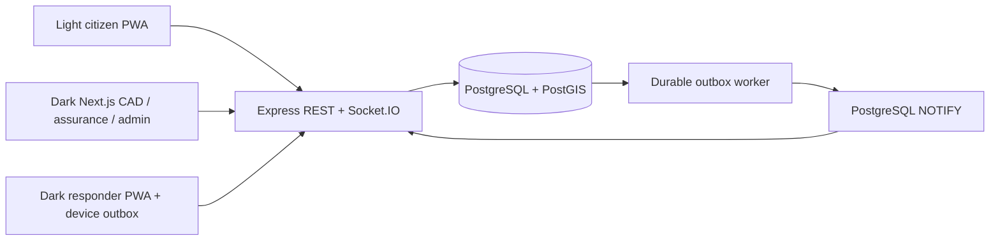

# Architecture

One TypeScript modular backend serves all role surfaces and owns authoritative commands. Next.js App Router serves command/assurance/admin; two React/Vite PWAs share the typed message contract and design system. TanStack Query reconciles REST snapshots at five-second intervals and on Socket.IO events/reconnect. Socket messages are hints, never human acknowledgements or proof of delivery.

`packages/contracts` defines Zod inputs and stable categories; `packages/domain` owns transition edges, canonical JSON/hash and verification. `packages/simulation` defines immutable fixture goals and step sequences. `packages/i18n` contains shared en-NG messages and formatting. `packages/ui` implements connected surfaces and reusable components.

## Command transaction

An actor-scoped key and canonical request fingerprint identify a command. A transaction-level advisory lock serialises same-key retries, returning the stored authoritative result. Different bodies under the same key fail. The incident row is locked; expected version, actor/agency/unit membership, legal state and current assignment are checked. Offer also locks the unit. Unique partial indexes protect one current assignment per incident and per unit. State, appended event, outbox and retry response commit together. Nested scenario commands share the transaction through AsyncLocalStorage.

Timestamps are UTC `timestamptz`. The server records commit-observed time separately from unverified device-claimed time. Event sequence and incident version are monotonic per aggregate. Corrections/reviews increment the version and append metadata; they never rewrite original assertions. Update/delete triggers protect the event table through ordinary application SQL.

## Delivery and replay

Dropped idle PostgreSQL connections are replaced without terminating the services. A dedicated LISTEN client reconnects with bounded backoff after database interruption, then requests REST reconciliation from connected clients.

The separate worker selects pending rows using `FOR UPDATE SKIP LOCKED`, sends NOTIFY within a transaction and marks notification dispatch. Delivery time means a PostgreSQL notification was committed, **not** that every socket/browser received or read it. If the API was offline, NOTIFY may be lost; committed history remains available via REST and clients reconcile after reconnect. Retry scheduling is bounded exponentially for worker delivery errors. Offer expiry runs in the worker and appends an explicit expiry transition.

Sessions are PostgreSQL-backed. Socket subscriptions derive exclusively from authenticated agency/unit or receipt capability, not arbitrary client room names. Public receipt projections never include narratives, precise coordinates, operators, units or internal notes.

## Data ownership and lifecycle

One persistent dataset connects citizen receipt, incident, assignments, event lineage, reviews, feedback and exports. Admin reset cancels current synthetic records with explicit events rather than deleting history. Receipt access expires; the owner controls retained research records. Local checkpoints are unsigned and not externally anchored. No Redis or paid map/routing provider is required.
