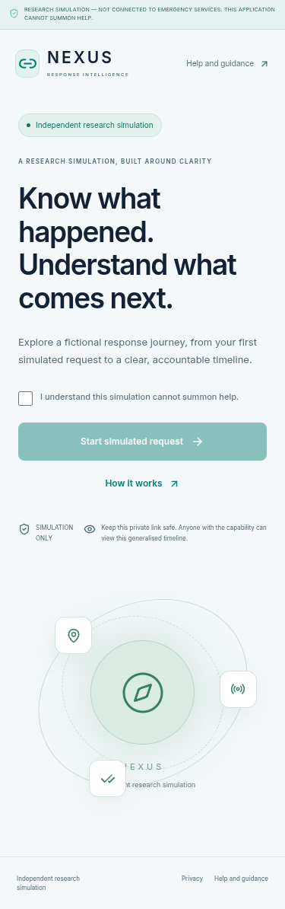
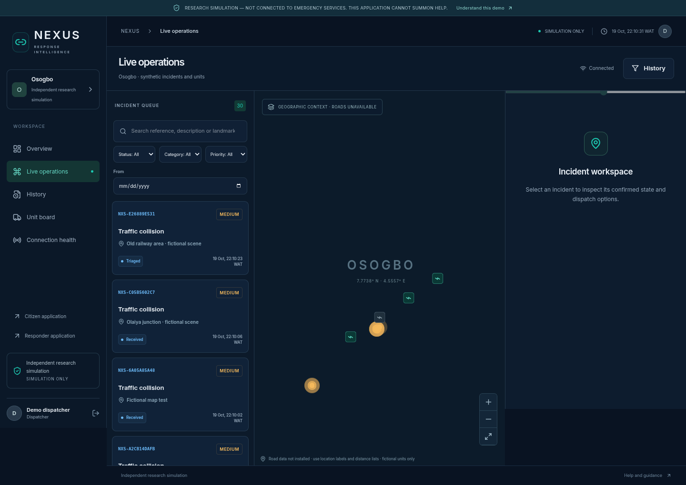
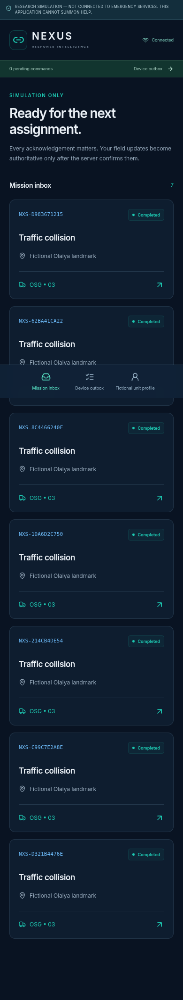
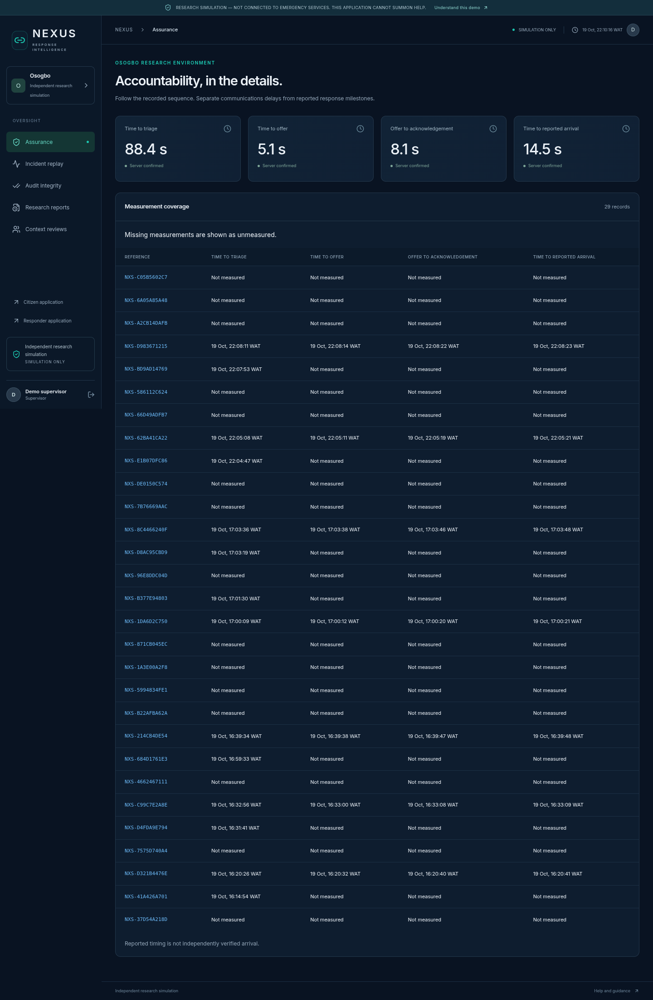
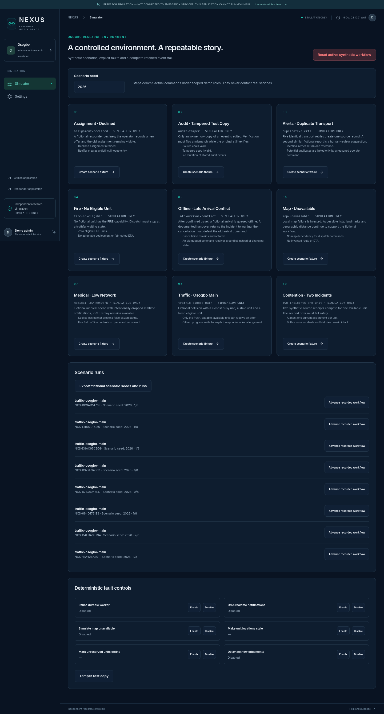

# Browser captures — NEXUS — Response Intelligence

Actual production Chromium screenshots captured 19 October 2026, then visually reviewed. Images are unaltered and use fictional data only. The citizen app is light; operations, responder, assurance and administrator remain dark. The visible simulation warnings are retained. These captures do not establish Windows or real-city routing verification. The dispatcher map honestly shows unavailable road data and a geographic context fallback.

| Workspace     | Capture                                               | Browser viewport       |
| ------------- | ----------------------------------------------------- | ---------------------- |
| Citizen       | [Open full screenshot](screenshots/citizen.png)       | 375 px wide, full page |
| Dispatcher    | [Open full screenshot](screenshots/dispatcher.png)    | 1440 × 900, full page  |
| Responder     | [Open full screenshot](screenshots/responder.png)     | 390 × 844, full page   |
| Supervisor    | [Open full screenshot](screenshots/supervisor.png)    | 1440 × 900, full page  |
| Administrator | [Open full screenshot](screenshots/administrator.png) | 1440 × 900, full page  |

## Citizen

## Dispatcher

## Responder

## Supervisor

## Administrator

