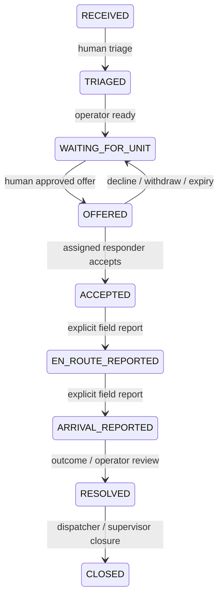

# Authoritative state machines

The ordinary incident path is:

Early RECEIVED/TRIAGED/WAITING_FOR_UNIT/OFFERED states can be cancelled with an operator reason. Accepted/active reassignment requires a documented handover, closes the previous assignment as REASSIGNED and returns the incident to waiting for a new offer. CLOSED/CANCELLED are terminal for ordinary workflow. Reviews/corrections can append without rewriting status.

Assignment lineage: OFFERED → ACCEPTED → ACTIVE → COMPLETED, or OFFERED → DECLINED/EXPIRED/WITHDRAWN. Accepted/active handover becomes REASSIGNED. Explicit simulator reset aborts current assignments and cancels active fictional aggregates while preserving history.

Delivery remains separate: QUEUED → SENT_UNCONFIRMED → server commit/removal, or FAILED_RETRYABLE / REJECTED_CONFLICT. An offline tap never advances central workflow. The device's claimed timestamp is unverified. A stale queued command cannot supersede cancellation, reassignment, expiry or a newer version.
